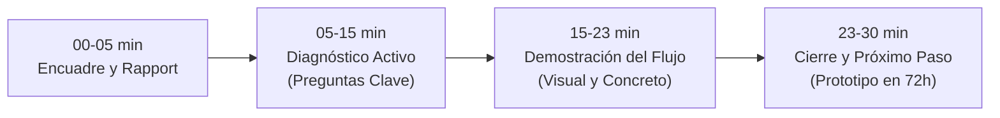
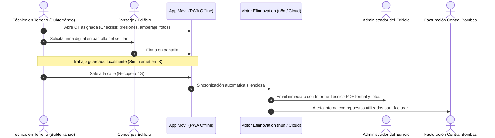

# Kit de Preparación: Reunión con Central Bombas (Francisco Vial)

**Cliente:** Central Bombas SpA  
**Interlocutor:** Francisco Vial (`fvial@centralbombas.cl`) — Dueño / Gerencia General  
**Giro:** Comercialización de bombas, mantención de salas hidráulicas, bombas de pozo y grupos electrógenos en edificios, condominios e industrias en Santiago (Sepúlveda Leyton 3068).  
**Contexto de la reunión:** Francisco respondió al correo en frío solicitando una videoconferencia a las **10:00 hrs** para conocer la propuesta de digitalización de órdenes de trabajo (OTs) en terreno.

---

## 1. Respuesta Inmediata para Confirmar la Reunión (Enviar Ahora)

> **Asunto:** Re: automatización de órdenes de trabajo en Central Bombas  
> **Para:** Francisco Vial \<fvial@centralbombas.cl\>  
>
> Hola Francisco, excelente.
>
> Confirmadísimo para mañana a las 10:00 hrs vía videoconferencia. 
>
> Te comparto el enlace directo de Google Meet para conectarnos:  
> 🔗 **[meet.google.com/xyz-abcd-efg](https://meet.google.com/)** *(o tu link habitual)*
>
> La idea es revisar de forma muy práctica cómo funciona el flujo en terreno: desde que el técnico hace la inspección en la sala de bombas (incluso sin señal en subterráneos) hasta que se genera el informe firmado para el administrador del edificio y la alerta de cobro para ustedes.
>
> Nos vemos mañana a las 10:00.
>
> Saludos cordiales,  
> **Franco Blanco**  
> Efinnovation SpA | +56 9 7426 3408

---

## 2. Anatomía del Dolor en Central Bombas (Lo que Francisco vive a diario)

Para liderar la reunión con autoridad, debes demostrar que conoces exactamente cómo opera una empresa de servicio técnico de salas de bombas en Santiago:

1. **Subterráneos sin señal (El dolor técnico #1):**
   * Las salas de bombas están en los niveles -2, -3 o -4 de edificios. **No hay señal 4G ni Wi-Fi**.
   * Cualquier aplicación web común se cae. La solución **debe funcionar 100% offline** y sincronizar en segundo plano cuando el técnico sube a la calle.
2. **Pérdida de repuestos y horas no cobradas:**
   * El técnico cambia un sello mecánico, un presostato, contactores o un manómetro en una emergencia de fin de semana.
   * Si no lo anota en el papel o la hoja se mancha con grasa o agua, **la empresa absorbe el costo** porque contabilidad nunca se enteró.
3. **El conserje no tiene poder de decisión:**
   * El conserje firma una hoja de papel arrugada. Esa hoja queda en la conserjería o en la camioneta del técnico durante días.
   * Mientras tanto, el **Comité de Administración o el Administrador del Edificio** exige el informe técnico para liberar el pago de la factura mensual o aprobar la cotización de reparación.
4. **Retraso de facturación de 15 a 30 días:**
   * Las OTs físicas llegan a la oficina en Sepúlveda Leyton a fin de mes. Una persona tiene que transcribir papeles a mano a Excel para poder emitir la factura.

---

## 3. Estructura de la Reunión (30 Minutos de Alto Impacto)

### Fase 1: Encuadre (0 a 5 min)
* Saludo profesional y agradecimiento por el tiempo.
* *"Francisco, la idea de hoy no es mostrarte una presentación de 40 diapositivas aburridas. Queremos entender cómo coordinas hoy a tus técnicos en la calle, mostrarte en 5 minutos cómo hemos resuelto esto para faenas en terreno con salas de máquinas y ver si hace sentido para Central Bombas."*

### Fase 2: Diagnóstico guiado — Hazlo hablar a él (5 a 15 min)
Lanza estas preguntas estratégicas. Quien hace las preguntas domina la reunión:
1. **Volumen:** *"¿Cuántos técnicos tienen hoy en la calle y cuántas salas de bombas atienden al mes entre preventivos y urgencias?"*
2. **El flujo actual:** *"Cuando un técnico termina de revisar una sala en un edificio, ¿cómo reporta hoy lo que hizo? ¿Usa papel autocopiativo, fotos por WhatsApp o un Excel?"*
3. **El punto ciego:** *"¿Les pasa que el conserje firma un papel, pero la administración del edificio no paga hasta que no le envían el informe técnico digital formal con fotos?"*
4. **La señal:** *"¿Cómo lidian hoy cuando los técnicos están en el subterráneo -3 y no tienen internet?"*
5. **Repuestos:** *"Si en una mantención detectan que hay que cambiar un rodamiento o una válvula de retención, ¿cómo viaja esa información desde la sala de bombas hasta tu equipo de ventas/facturación?"*

### Fase 3: La Solución Concreta (15 a 23 min)
Preséntale el flujo en 3 piezas sencillas:

1. **Para el Técnico (Teléfono móvil):**
   * App ultraligera (no requiere instalar cosas pesadas desde Play Store/App Store, abre como acceso directo PWA).
   * **Modo Offline total:** Carga la lista de edificios del día. Puede estar en el subterráneo más profundo: registra presiones (bar/PSI), amperajes de bombas 1, 2 y 3, estado de presostatos, fotos del tablero eléctrico y firma del conserje con el dedo.
2. **Para la Administración del Edificio (El cliente de Central Bombas):**
   * En cuanto el técnico sale del edificio y el teléfono capta 4G, el sistema compila un **PDF corporativo impecable con el logo de Central Bombas**, las fotos fechadas del antes/después y la firma del conserje.
   * Se envía automáticamente por correo al administrador del condominio: *"Informe de mantención mensual sala de bombas finalizado"*.
3. **Para Francisco y su oficina:**
   * Panel en tiempo real: quién está en qué edificio, qué salas faltan por revisar hoy y qué repuestos se consumieron.
   * Facturación inmediata sin esperar a fin de mes.

### Fase 4: Manejo de Objeciones Habituales

* **"Mis técnicos son mayores y no son amigos de la tecnología":**
  * *Respuesta:* *"Exactamente por eso no les pasamos un software empresarial complejo tipo SAP o Salesforce. La interfaz que diseñamos tiene botones grandes, requiere solo 4 toques, sacar 2 fotos y pedir la firma. Es más rápido que buscar un lápiz que raye en una sala húmeda."*
* **"¿Cuánto cuesta esto?":**
  * *Respuesta:* *"Nosotros no cobramos licencias millonarias por usuario como las multinacionales. Trabajamos con un desarrollo a medida sobre componentes ágiles (n8n / cloud privado), lo que reduce el costo a una fracción accesible para una pyme de servicios. Pero antes de hablar de números, prefiero validar que el flujo te ahorre horas reales de trabajo."*
* **"¿Cuánto tardan en implementarlo?":**
  * *Respuesta:* *"Un software tradicional tarda 6 meses. Nosotros montamos un prototipo funcional con sus propios campos y logo en menos de 2 semanas."*

---

## 4. El Cierre Ganador (Llamado a la Acción)

No termines la reunión diciendo *"bueno, te mando una cotización por correo"*. Propón este siguiente paso de bajo riesgo:

> *"Francisco, para no adivinar lo que necesitas: ¿te parece si me envías por WhatsApp o correo la foto de una orden de trabajo real de las que usan hoy tus técnicos (en papel o Excel)? Con eso, nosotros configuramos una maqueta funcional con el logo de Central Bombas y en 72 horas te muestro cómo se vería operando en el teléfono. Si te gusta cómo fluye, vemos números; si no, no habrás gastado un solo peso."*
